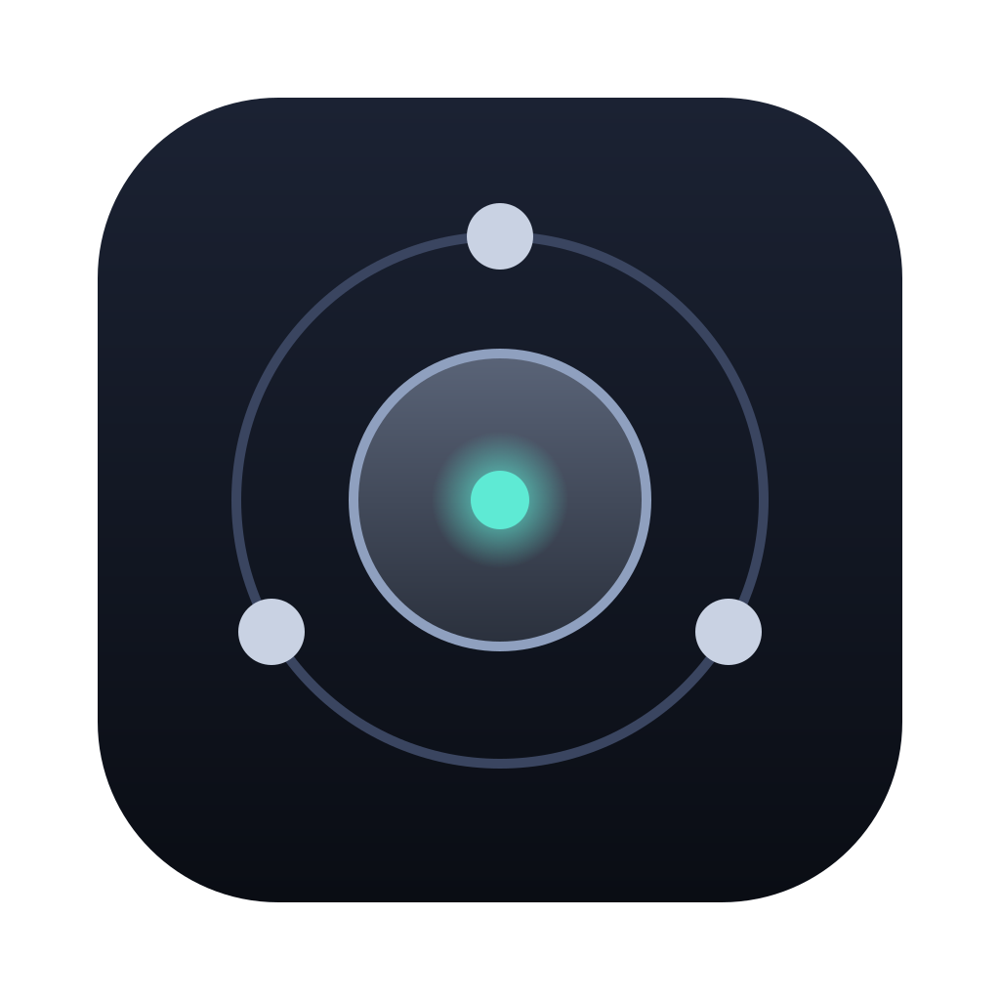
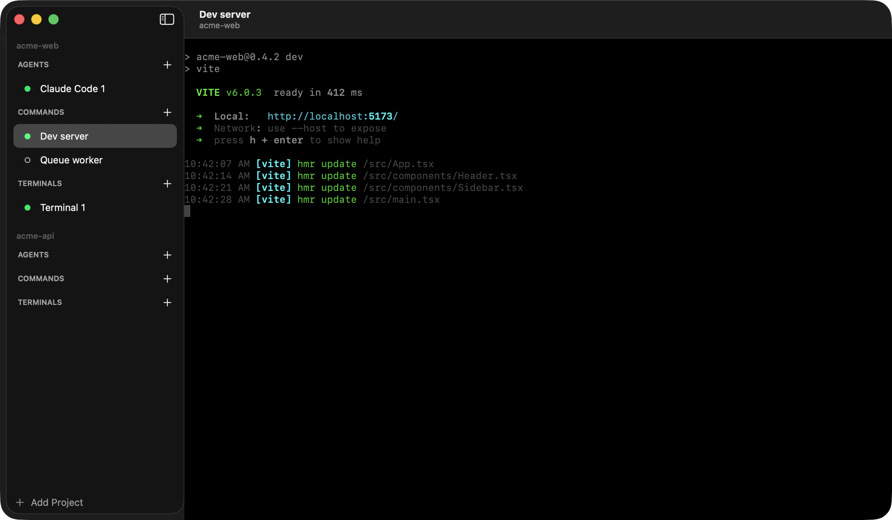
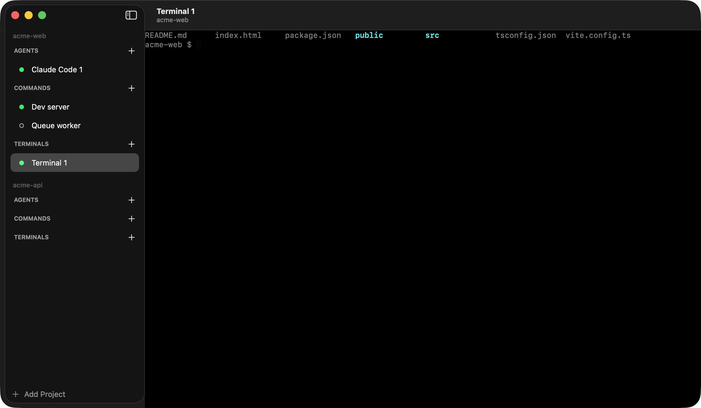

  

<h1 align="center">The Mothership</h1>

A native macOS command center for your projects. Each project in the sidebar has its **agents** (Claude Code, Codex, …), **commands** (dev servers, queue workers, …) and **terminals**, all running in tmux, so they keep running when you quit or rebuild the app.

## Installation

You need macOS 15 or later, the Xcode command line tools (Swift 6) and tmux:

    xcode-select --install
    brew install tmux

Then build the app and copy it to Applications:

    git clone https://github.com/digital-drifter/the-mothership.git
    cd the-mothership
    ./scripts/build-app.sh
    cp -R build/Mothership.app /Applications/

## Usage

1. **Add a project:** click **Add Project** at the bottom of the sidebar (or press ⌘O) and choose the project's folder.
2. **Start an agent:** click **+** next to Agents and pick one. **Custom…** runs any one-off command.
3. **Add a command:** click **+** next to Commands and give it a name and a command such as `npm run dev`. It is added stopped: click the play button on its row to start it, and the stop button to stop it. Tick **Start automatically** to have it start whenever Mothership opens. Right-click a command to restart, edit or delete it.
4. **Open a terminal:** click **+** next to Terminals for a shell in the project folder.
5. **Choose your agents:** open **Settings** (⌘,) and tick the agents you use. Only those appear in the Agents **+** menu.

Drag an agent, command or terminal up or down to reorder it within its group.

Right-click a project's name to rename it, point it at a different folder, or remove it. Removing a project never touches its folder.

Quitting with ⌘Q leaves everything running; it is all there again the next time you open the app. Use ⌥⌘Q to stop everything and quit.

## Shortcuts

| Shortcut | Action |
| --- | --- |
| ⌘1 … ⌘9 | Select the first item of the Nth project and expand it |
| ⌘O | Add Project |
| ⌘, | Settings |
| ⌘Q | Quit, leaving every session running |
| ⌥⌘Q | Stop All and Quit: asks to confirm, then ends every session |

## Where things live

- Your projects and settings: `~/Library/Application Support/Mothership/projects.json`, managed by the app.
- Sessions run on a private tmux server, separate from your own tmux. To list them from a shell: `tmux -L mothership ls`.

## Development

    swift test              # run the tests
    ./scripts/build-app.sh  # build build/Mothership.app

The app icon is drawn in `Resources/AppIcon.svg`. After editing it, run `scripts/make-icon.sh` (needs `brew install librsvg`).
